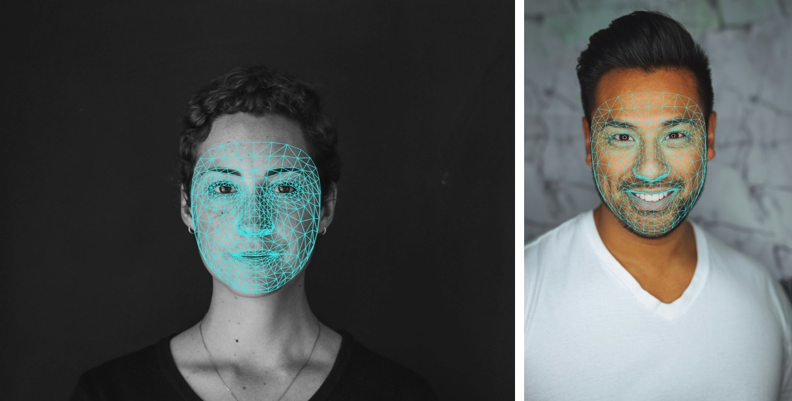
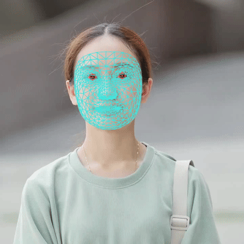
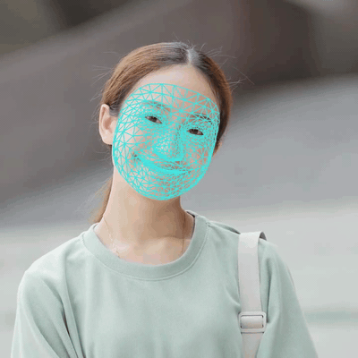

# Face Mesh: 468 / 478 dense facial landmarks

[](https://github.com/yakhyo/mediapipe-face-mesh-onnx/releases)
[](LICENSE)

> [!TIP]
> The models and functionality in this repository are being integrated into [UniFace](https://github.com/yakhyo/uniface), an all-in-one face analysis toolkit.<br>
> [](https://pypi.org/project/uniface/) [](https://github.com/yakhyo/uniface/stargazers)

[MediaPipe Face Mesh](https://github.com/google-ai-edge/mediapipe/wiki/MediaPipe-Face-Mesh) turns a 192×192 face crop into 468 dense 3D landmarks, and every face in an image goes through the model in one batched session call. MediaPipe's own BlazeFace short-range detector is bundled here, so there is no separate detector to wire up.

MediaPipe's newer **Face Landmarker** is also ported: 478 landmarks from a 256×256 crop, adding ten iris points to the same mesh. Both landmark models share one detector, one ROI recipe, and one drawing path — pick by size or by whether you need irises.



## Install

```bash
pip install -r requirements.txt
```

Then download the weights below into `weights/`.

## Models

| Model | Input | Output | ONNX | PyTorch |
| ----- | ----- | ------ | ---- | ------- |
| Face Mesh (N-batch, default) | Nx3x192x192 | 468 × (x, y, z) | [Link](https://github.com/yakhyo/mediapipe-face-mesh-onnx/releases/download/weights/face_mesh_Nx3x192x192.onnx) | [Link](https://github.com/yakhyo/mediapipe-face-mesh-onnx/releases/download/weights/face_mesh_192x192.pt) |
| Face Landmarker (with irises) | Nx3x256x256 | 478 × (x, y, z) | [Link](https://github.com/yakhyo/mediapipe-face-mesh-onnx/releases/download/weights/face_landmarker_Nx3x256x256.onnx) | [Link](https://github.com/yakhyo/mediapipe-face-mesh-onnx/releases/download/weights/face_landmarker_256x256.pt) |
| BlazeFace short-range (bundled detector) | Nx3x128x128 | 896 anchors | [Link](https://github.com/yakhyo/mediapipe-face-mesh-onnx/releases/download/weights/face_detection_short_range.onnx) | [Link](https://github.com/yakhyo/mediapipe-face-mesh-onnx/releases/download/weights/face_detection_short_range.pt) |

All three graphs hold the bare networks. Anchor decoding, weighted NMS, and the mapping from crop coordinates back to the image all run in Python.

None of the ONNX files is a redistribution of somebody else's. `onnx_export.py` builds every one of them from the `.pt` state dicts in this repository, and those trace back through:

```
Google .tflite  ->  [intermediate ONNX, read for weight tensors only]  ->  hand-written nn.Module  ->  .pt  ->  onnx_export.py  ->  shipped .onnx
```

The bracketed step was a convenience for reading tensors out of the older two graphs, not a source of the shipped file:

- Face Mesh: the intermediate was [PINTO0309's conversion](https://github.com/PINTO0309/facemesh_onnx_tensorrt) of `face_landmark.tflite`
- BlazeFace: a local `tf2onnx` conversion of the `face_detection_short_range.tflite` bundled in the mediapipe 0.10.14 wheel
- Face Landmarker: no intermediate at all — the weights were read directly out of `face_landmarks_detector.tflite`, extracted from Google's `face_landmarker.task` bundle. Unlike the older 478-point attention model that graph holds no custom ops, so it maps onto the `nn.Module` without a conversion step

Google stores the weights in all of these `.tflite` files as float16. They are dequantized to float32 when read, and everything downstream — `.pt`, ONNX, inference — is float32. No quantization is introduced anywhere; the values simply carry the float16 precision of Google's release.

## Run it

```bash
python onnx_inference.py assets/inputs/man_smiling.jpg      # one image
python onnx_inference.py assets/inputs/*.jpg --save-dir assets/results
python onnx_inference.py 0                                  # webcam
python onnx_inference.py 0 --mesh points                    # full | partial | points

# 478 points with irises
python onnx_inference.py 0 -m weights/face_landmarker_Nx3x256x256.onnx
```

Same clip through both models here and through original MediaPipe:

| Face Mesh (468) | Face Landmarker (478) | Original MediaPipe |
| :-: | :-: | :-: |
|  |  |  |

The irises are the only visible difference between the first two, and they are small
at this scale — [assets/results/woman_478.jpg](assets/results/woman_478.jpg) shows them
at full resolution.

### Python

```python
import cv2
from models import BlazeFace, FaceMesh

image = cv2.imread('assets/inputs/man_smiling.jpg')
detector = BlazeFace('weights/face_detection_short_range.onnx')
mesher = FaceMesh('weights/face_mesh_Nx3x192x192.onnx')
# ...or FaceMesh('weights/face_landmarker_Nx3x256x256.onnx') for 478 points with irises;
# input size and landmark count are read from the graph.

bboxes, keypoints, _ = detector.detect(image)
landmarks, scores = mesher.predict(image, bboxes, margin=0.25, keypoints=keypoints)
print(landmarks.shape, scores.shape)  # (N, 468, 3) (N,)
```

`predict` returns two arrays:

| Array | Shape | What it holds |
| ----- | ----- | ------------- |
| `landmarks` | `(N, 468, 3)` | `x` and `y` in full-image pixels, `z` relative depth on the same scale (smaller is closer, comparable only within one face) |
| `scores` | `(N,)` | Face presence probability between 0 and 1 |

The topology is MediaPipe's canonical 468-point mesh, and the drawing edge lists ship in [models/tessellation.py](models/tessellation.py). The 478-point model keeps those first 468 points in the same order and appends the irises, so the same tessellation draws either one. Iris points are 468-472 (left) and 473-477 (right), each ordered center, right, top, left, bottom.

> [!IMPORTANT]
> The graph's raw score output is a logit, not a probability. Confident faces land around 20 to 40. `FaceMesh` applies the sigmoid for you, but if you run the ONNX file yourself, don't threshold that raw number as if it were in [0, 1].

## PyTorch

[models/model.py](models/model.py) holds `FaceMeshNet`, `FaceLandmarkerNet`, and `BlazeFaceNet`, hand-written `nn.Module` architectures recovered from MediaPipe's graphs. `inference.py` runs the same detect-then-mesh pipeline on them behind the same CLI:

```bash
python inference.py assets/inputs/woman.jpg --save-dir assets/results
python inference.py 0 --model landmarker                    # 478 points with irises
```

- Agrees with the ONNX path to within 5e-4 px (1e-4 for Face Mesh, 4e-4 for Face Landmarker)
- `torch` is wanted only here (`pip install torch`); the ONNX pipeline never imports it
- No BatchNorm layers anywhere, because TFLite folds normalization into the surrounding convolution weights at export time. Google's own `.tflite` files contain no BN ops either.

## Parity with original MediaPipe

Face Mesh was verified against `mediapipe==0.10.14`, the last release whose wheels still carry the legacy `mp.solutions` API and the bundled `face_landmark.tflite`. Face Landmarker was verified against the current Tasks API, which is what ships it:

| Comparison | Agreement |
| ---------- | --------- |
| Face Mesh, model level vs the original tflite | 1e-4 px |
| Face Mesh, full pipeline vs `mp.solutions.face_mesh` static mode | ~0.03 px, or 0.01% of inter-ocular distance |
| Face Landmarker, model level vs the original tflite | 6e-4 px |
| Face Landmarker, full pipeline vs the MediaPipe Tasks API | 0.007% of inter-ocular distance |

These rows say the port reproduces Google's model, not that the model is accurate. For that, Google's own [MediaPipe FaceMesh V2 model card](https://storage.googleapis.com/mediapipe-assets/Model%20Card%20MediaPipe%20Face%20Mesh%20V2.pdf) evaluates the 478-point model on 1700 selfies spread evenly across 17 geographical subregions:

| Mode | IOD MAE | Std |
| ---- | ------- | --- |
| Tracking (crop from the previous frame) | 2.62% | 1.03 |
| **Reacquisition (detector, then one mesh pass)** | **3.24%** | 1.29 |

Reacquisition is the mode this repo runs — detect, crop, single pass — so 3.24% is the figure that applies here, not the 2.62% headline. Google puts human-annotator disagreement at 2.56% IOD MAE for reference, and reports the spread across genders (0.01%) and skin tones (0.41-0.66%) as within their fairness criteria.

No equivalent card was published for the 468-point model, so there is no official accuracy number to compare the two against.

None of these checks are wired into the repo, and `mediapipe` is not a dependency here.

## Notes and limitations

- **Crop geometry matters.** The ROI is a square built from the long side of the detector box, scaled 1.5x (`--margin 0.25`), rotated so the eyes sit level — exactly the "25% margin on each side" the model card specifies. It tolerates only ~10% shift or scale error and 8° of roll, so tight, stretched, or tilted crops degrade the mesh.
- **One pass per face**, matching MediaPipe's static-image flow. Its `landmarks_to_roi` step feeds the *next video frame*, not a second pass over the same image, so it is deliberately not applied.
- **Face Landmarker is the heavier of the two**, 113 against 35 MMac, though the wall-clock gap is narrower since neither model saturates a modern CPU. It is an addition, not a replacement.
- **The older 478-point *attention* model is not ported.** It needs three MediaPipe-only TFLite custom ops that no standard runtime can load, and its iris depth is averaged from the eye contour rather than predicted.
- **No blendshapes.** Google ships `face_blendshapes.tflite` separately for that. The Face Landmarker graph does carry a third output — the model card calls it "a limited set of blendshapes" — which is not exported, keeping both nets to two outputs.

## License and attribution

[Apache-2.0](LICENSE). The model and the mesh topology originate from Google's [MediaPipe](https://github.com/google-ai-edge/mediapipe) (Apache-2.0), and the Face Mesh weights were sourced through [PINTO0309's ONNX conversion](https://github.com/PINTO0309/facemesh_onnx_tensorrt) (Apache-2.0).
